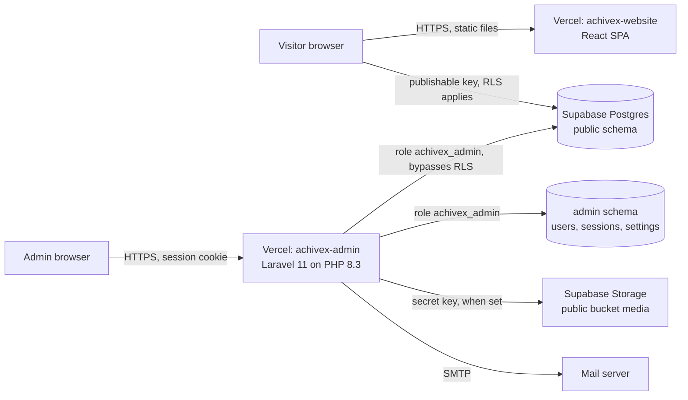

# AchiveX Security Audit

Date: 20 October 2026. Scope: the React website (`website/`), the Laravel admin panel (`admin/`), the Supabase project `pktnqerzatrdndhbtsqp`, and the two Vercel projects (`achivex-website`, `achivex-admin`).

No live penetration test, brute force test or scan was run against production. Database findings come from read only queries. No production data was changed during the audit.

## 1. Executive summary

The system is in reasonable shape. The browser only holds the public Supabase key, row level security is on for every public table, the admin schema is not reachable from the browser, and the admin panel checks roles on every protected route.

No critical issue was found. The most important problems were in the admin panel: spreadsheet formula injection in CSV exports, a session cookie without the Secure flag, sessions that survived a password change, and secrets stored in plain text. These are fixed in branch `claude/security-hardening` with tests, and that branch is deployed to both Vercel projects (21 October 2026).

After the second pass (see the end of section 4), the database changes, the Laravel 12 upgrade, the form spam limit and admin two-step login are done. The owner still needs to rotate two credentials that appeared in an AI session transcript and remove one unneeded variable (section 8).

This audit does not make the system unhackable. An independent penetration test is still recommended before handling sensitive customer data.

## 2. Architecture and trust flow



* Visitors never log in. The website reads published content and inserts contact messages, guide requests, page views and 404 hits directly into Supabase. RLS is the only control on that path.
* Admins log in to Laravel with email and password. Laravel is the only source of identity and roles for the admin. Supabase Auth is not used.
* Laravel talks to the database as `achivex_admin`, a dedicated role with `BYPASSRLS` and read/write grants on the `admin` and `public` schemas only.
* There is one organisation and no customer accounts, so there is no multi tenant data to isolate.

## 3. Database authorization matrix

| Table | Browser (anon) can | Notes |
|---|---|---|
| blog_posts, case_studies, news_posts, whitepapers, job_openings, team_members, pages | read rows where `published` | No write policy, so writes are denied |
| page_sections | read rows where `visible` | |
| redirects | read rows where `active` | |
| hero_stats, locations, milestones, seo_meta, site_settings | read all | Public site content |
| contact_submissions, whitepaper_requests | insert only | Cannot be read back. See finding M3 |
| page_views, not_found_log | insert only | See finding M3 |
| everything in schema `admin` | nothing | No schema usage grant for anon or authenticated |

Supabase security advisor: no warnings. No SQL functions, triggers or views exist in `public` or `admin`, so there is no SECURITY DEFINER bypass.

## 4. Findings

Status: **Fixed** means fixed in branch `claude/security-hardening` and deployed. **Open** means it needs a decision or manual action.

### High

| ID | Finding | Evidence | Status |
|---|---|---|---|
| H1 | Laravel 11.57 is out of security support and has a published high advisory (CRLF accepted by the `email` rule, GHSA-5vg9-5847-vvmq) plus a medium one (signed URL path confusion) | `composer audit` | Fixed (second pass): upgraded to Laravel 12.70. `composer audit` reports no advisories |

### Medium

| ID | Finding | Evidence | Status |
|---|---|---|---|
| M1 | CSV formula injection. Contact messages and page views come from the public. An attacker can submit `=HYPERLINK(...)` and it runs when an admin opens the export in Excel | `InboxController::csv`, `AnalyticsController::export` | Fixed: `App\Support\Csv` prefixes risky cells |
| M2 | Admin session cookie had no Secure flag because `SESSION_SECURE_COOKIE` was unset | `config/session.php`, `api/index.php` | Fixed: defaults to Secure on Vercel. Verified in a local request |
| M3 | Browser inserts can set any column, including `id`, `created_at`, `read_at`, `starred`, `handled_at`. Spam is not rate limited | column privileges on 4 insert-only tables | Fixed (second pass): browser roles may only insert the form fields, and a database trigger allows at most 3 submissions per email in 10 minutes and 20 per form per minute. Tested inside rolled back transactions |
| M4 | A password reset or password change did not end other sessions or "remember me" logins, so a stolen session stayed valid | `PasswordResetController`, `ProfileController`, `User` | Fixed: password or role change deletes the user's other sessions and rotates the remember token |
| M5 | SMTP password and Supabase secret key were stored as plain JSON in `admin.app_settings` and in the cache table | `AppSetting::put` | Fixed: encrypted with `APP_KEY`. Table was empty, so nothing to migrate |
| M6 | No security headers on either app (clickjacking, MIME sniffing, admin indexable by search engines) | response headers | Fixed: admin middleware `SecurityHeaders`; website CSP and headers in `vercel.json`. CSP tested on 5 pages with 0 violations |
| M7 | Credentials appeared in an AI assistant session transcript during setup (the admin database role password and `APP_KEY`) | this session | Open: rotate, see section 8 |
| M8 | No multi factor authentication for admin logins | `AuthController` | Fixed (second pass): optional two-step login with an authenticator app and one time recovery codes, under Profile. Each admin must turn it on |

### Low

| ID | Finding | Status |
|---|---|---|
| L1 | Upload validation checked file contents but saved the client's file extension | Fixed: `extensions:` rule added |
| L2 | Redirect targets accepted any text, for example `javascript:` | Fixed: must start with `/` or `http(s)://` |
| L3 | Links from admin settings and page builder were rendered without a scheme check | Fixed: `safeHref()` on the website |
| L4 | User role field accepted any string | Fixed: limited to administrator, editor, author |
| L5 | Analytics export accepted any number of days | Fixed: capped at 366 |
| L6 | React Router 6 advisories (open redirect with backslash, SSR constructor injection) | Fixed (second pass): upgraded to React Router 7.18.4. `npm audit --omit=dev` reports 0 |
| L7 | SVG uploads allowed in the public `media` bucket. SVG can carry script, but it is served from the Supabase domain, not the site | Fixed (second pass): SVG removed from allowed upload types |
| L8 | Password policy is 8 characters with no breached password check | Fixed (second pass): at least 10 characters with letters and numbers, checked against known breaches (Have I Been Pwned, only a hash prefix is sent) |
| L9 | `DB_PASSWORD` was added to the website Vercel project, which does not need it | Open: delete it there |

Confirmed not vulnerable: SQL injection (all raw SQL is static, the rest uses the query builder), mass assignment (resources only save declared fields), CSRF (Laravel web middleware), XSS in Blade (all `{!! !!}` output is static or escaped), secrets in Git history or the website bundle (none found), login brute force (5 attempts per email and IP, plus 20 per minute per IP).

### Second pass (20 October 2026)

Re-checked after the email, upload, backup, cache and custom code features were added.

| ID | Finding | Status |
|---|---|---|
| S1 | Custom Code (Tools menu) lets an administrator add HTML, CSS and JavaScript to every page. This is stored cross site scripting by design | Accepted: administrators only. The website CSP still blocks inline and third party scripts, so only HTML and CSS take effect until the owner decides to allow specific script domains |
| S2 | `/hooks/inbox` is public | Accepted: it takes no input, only emails rows not yet emailed, and is limited to 30 calls a minute |
| S3 | Direct uploads to Supabase skip the server's content check | Mitigated: the signed path is tied to the admin session, the extension must be on the allow list, and the stored type is checked after upload |
| S4 | Supabase storage has no policies for browser roles | Confirmed safe: only the service key can write to the `media` bucket |
| S5 | Build tool advisory (`braces` through Tailwind CSS 3) | Accepted: build time only, not shipped to visitors. Clears with a Tailwind 4 upgrade |

Supabase security advisor: no warnings.

## 5. Files changed

| File | Why |
|---|---|
| `admin/app/Support/Csv.php` | New: CSV cell sanitising (M1) |
| `admin/app/Http/Controllers/Admin/InboxController.php`, `AnalyticsController.php` | Use it; cap export range (M1, L5) |
| `admin/api/index.php` | Secure session cookie on Vercel (M2) |
| `admin/app/Models/User.php` | End other sessions on password or role change (M4) |
| `admin/app/Models/AppSetting.php` | Encrypt secret settings (M5) |
| `admin/app/Http/Middleware/SecurityHeaders.php`, `admin/bootstrap/app.php` | Admin security headers (M6) |
| `vercel.json` | Website CSP and headers (M6) |
| `admin/app/Http/Controllers/Admin/MediaController.php` | Extension check (L1) |
| `admin/app/Admin/Resources/RedirectResource.php`, `SeoController.php` | Redirect target rule (L2) |
| `website/src/utils/safeHref.js` and 5 components | Safe link schemes (L3) |
| `admin/app/Admin/Resources/UserResource.php` | Role whitelist (L4) |
| Auth, PasswordReset, Profile, Settings, Seo controllers, Location and User resources | Reject line breaks in emails (H1 mitigation) |
| `admin/tests/Feature/SecurityTest.php`, `admin/tests/Unit/CsvTest.php` | Regression tests |
| `admin/tests/Feature/ExampleTest.php` | Was failing before: `/` redirects to `/admin` |

## 6. Tests run and results

| Test | Result |
|---|---|
| Admin PHPUnit suite (12 tests, 62 assertions, in-memory SQLite) | Pass |
| Same new tests against the old code | 7 of them fail, which shows they catch the issues |
| Guest access to 8 protected admin URLs | All redirect to login |
| Author and editor access to users, settings, exports, storage key | All 403 |
| Website `safeHref` cases (14, including `javascript:`, `data:`, `//evil`) | Pass |
| Website build with CSP, browser check of 5 pages | 0 CSP violations, headings render |
| Admin login page through the Vercel entry point | 200, headers present, cookie Secure + HttpOnly + SameSite=Lax |
| `npm audit` (website) | 2 moderate (React Router, see L6) |
| `composer audit` (admin) | Laravel advisories, see H1 |

Not run: tests against the real Supabase database, OWASP ZAP or any scan against live URLs, and the CRLF test does not prove the Laravel bug itself (the sample address is rejected by both old and new code).

## 7. Database changes (applied in the second pass)

Both are non destructive and reversible. They were applied on 20 October 2026 after the owner asked for the findings to be resolved, together with the `limit_form_spam` trigger and three new nullable columns on `admin.users` for two-step login.

```sql
-- M3: the browser may only fill the form fields; ids, dates and admin flags are set by the database or the admin.
revoke insert on public.contact_submissions, public.whitepaper_requests, public.page_views, public.not_found_log from anon, authenticated;
grant insert (name, email, phone, service, message) on public.contact_submissions to anon, authenticated;
grant insert (whitepaper_slug, name, email, company, job_title) on public.whitepaper_requests to anon, authenticated;
grant insert (path, referrer, device, visitor) on public.page_views to anon, authenticated;
grant insert (path, referrer) on public.not_found_log to anon, authenticated;

-- Defence in depth: RLS already blocks these, but the browser roles do not need the privileges at all.
revoke update, delete, truncate on all tables in schema public from anon, authenticated;
```

## 8. Manual actions for the owner

1. **Rotate the `achivex_admin` database password** in the Supabase SQL editor (`alter role achivex_admin password '<new>'`), then put the new value in `DB_PASSWORD` of the **achivex-admin** Vercel project and redeploy.
2. **Rotate `APP_KEY`** in the achivex-admin Vercel project (generate with `php artisan key:generate --show`). All admins will need to log in again.
3. Delete `DB_PASSWORD` from the **achivex-website** Vercel project.
4. Every administrator: turn on two-step login under Profile.
5. Turn on two factor authentication for the Vercel, Supabase and GitHub accounts.
6. In Supabase Auth, turn off public sign ups if Supabase Auth is not used.
7. If the admin moves to a custom domain, add it to `frame-ancestors` in `vercel.json` so the page builder preview keeps working.

## 9. Production readiness checklist

- [x] Deploy branch `claude/security-hardening` (done; still merge it into `main`)
- [x] Approve and run the SQL in section 7 (done in the second pass)
- [ ] Rotate the database password and `APP_KEY` (section 8)
- [ ] Remove `DB_PASSWORD` from the website project
- [ ] Two factor authentication on Vercel, Supabase, GitHub
- [x] Rate limiting for the contact and guide forms (database trigger)
- [x] Laravel 12 upgrade
- [x] Admin two-step login built (each admin must turn it on)
- [ ] Independent penetration test on a staging copy
